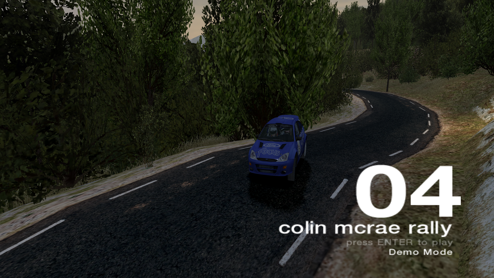
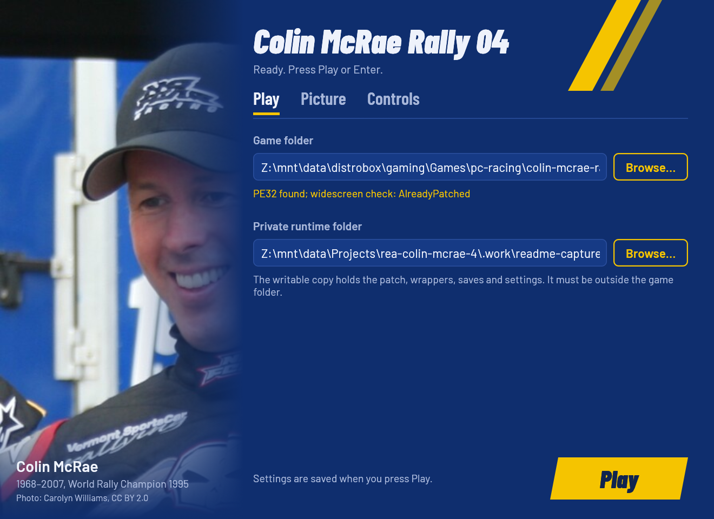
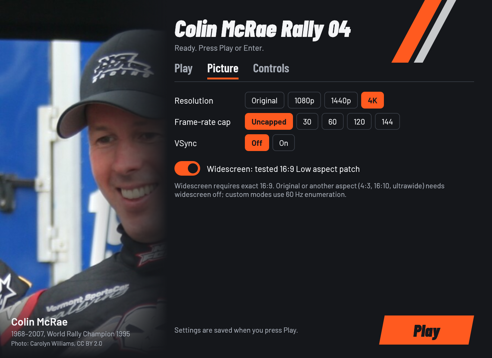

# Colin McRae Rally 04 Launcher

Run your own installed PC copy of **Colin McRae Rally 04** on Windows 10/11,
or on Linux through Wine, Steam/Proton, or the AppImage. Point the launcher at
the game folder, pick a look, and press **Play**: the widescreen picture, the
graphics wrappers, the gamepad and the game's first-run state are set up for
you.

[](https://new-uploads-akitaonrails.s3.us-east-2.amazonaws.com/2026/11/02/colin-mcrae-rally-04/showcase-h264.mp4)

*Version 0.2.0 from the settings window to a full USA stage: correct 16:9
proportions on the landscape monitor, driven with a pad's stick and analogue
triggers. Click to watch (2⅓ minutes, with sound).*

This repository and its packages contain **no game files**. The launcher never
modifies the installed game folder; everything it changes lives in a private
copy (the *runtime*).

## Problems it solves

Each item below is a problem the game has on a modern PC, followed by what
the launcher does about it.

**Runs on today's computers**

- **Crashes on a fresh install.** CMR04 needs install paths and first-run
  graphics defaults in the registry. The launcher writes the paths on every
  launch and adds the defaults only when they are missing.
- **Old Direct3D 9 renderer.** The launcher installs the tested dgVoodoo2
  2.80 wrapper. Under Wine or Proton it also adds DXVK, so the game draws
  through Vulkan on your graphics card.
- **Closing the game does nothing.** CMR04 ignores Alt+F4 and window-close
  requests (Super+W in Hyprland), so it had to be killed. A small hook
  built from this repository (`cmr4close.dll`) now ends it when you press
  Alt+F4 or close its window.

**Picture**

- **Widescreen that squeezes the cars.** The known 16:9 patch is easy to
  get wrong. Rendered directly at 16:9, cars and scenery come out 25% too
  narrow. The patch was made for a 4:3 picture stretched to 16:9, so the
  launcher has the game render 4:3 (2880x2160 for a 4K screen) and dgVoodoo
  stretch it. You get correct proportions and the wider view.
- **A thin, squashed strip with two monitors.** With a portrait monitor
  set as primary, the picture was fitted to that portrait screen and then
  stretched onto the landscape one. The launcher now sends the game to
  your largest landscape monitor.
- **Picking settings.** Choose a look in one click: Original, 4K (the
  largest exact 16:9 that fits your screen), Steam Deck or Custom. There
  is also an optional frame-rate cap and forced vsync.
- **Still to do:** the HUD (speedometer, timer) is drawn for 4:3 and stays
  slightly wide at 16:9. Fixing it would need another patch to the game.

**Gamepads**

- **The pad works in menus but not in a race.** In our tests with Wine
  alone, the pad's buttons reached the game but its stick and triggers
  didn't, and the old mapping turned the pad into keyboard keys, which also
  hid the axes. Bundled Xidi now presents a classic gamepad: the
  left stick steers, RT and LT are analogue pedals, and a resting thumb on
  the stick can't open the throttle.
- **Every new player had to set up the pad.** New profiles start on the
  keyboard, and choosing the controller in the game's own menu can freeze
  it under Wine. For a profile whose controls were never set up, the
  launcher selects your pad, analogue pedals and the game's axis tuning,
  so you can drive straight away. A profile you set up yourself is left as
  it is.

**Your files**

- **Patches and wrappers could damage your install.** The installed game
  folder is only read, never changed. A private copy (the runtime) holds
  the patched `cmr4.exe`, the wrappers, settings and saves.
- **Updates could overwrite your saves.** Later launches update the
  runtime without overwriting your saves, settings or DLL mods you added
  yourself.



## Verification status

Verified on Linux (Wine 11.21, RTX 5090, 4K screens, an 8BitDo Ultimate 2):

- **Picture:** correct 16:9 proportions in stages with widescreen on (4:3
  render stretched to 3840x2160), filling the landscape monitor with a portrait
  primary monitor present.
- **Closing:** Super+W ends the game.
- **Gamepad:** with Xidi on, stick steering and analogue RT/LT pedals in a
  stage; menus with the D-pad and A. A brand-new profile set up by the launcher
  drove without opening Options.
- **Settings window:** presets, palette and gamepad navigation render under
  Wine.

Not yet verified: native Windows, Steam Deck/Proton separately, protected
retail discs, and other pad models. Details and the evidence behind each fix:
[docs/RUNTIME_NOTES.md](docs/RUNTIME_NOTES.md) and
[docs/RESEARCH.md](docs/RESEARCH.md).

## Download

- **Windows:** [CMR4Launcher-v0.2.0.zip](https://github.com/akitaonrails/rea-colin-mcrae-4/releases/latest/download/CMR4Launcher-v0.2.0.zip)
- **Linux AppImage:** [CMR4Launcher-v0.2.0-x86_64.AppImage](https://github.com/akitaonrails/rea-colin-mcrae-4/releases/latest/download/CMR4Launcher-v0.2.0-x86_64.AppImage)

## What you need

An installed Windows copy of **Colin McRae Rally 04** with `cmr4.exe` in its
folder. No installer, disc, executable, media or game data is supplied here.

The launcher accepts an executable with exactly one tested widescreen
signature, original or already patched. Anything else stops safely and shows
the executable's SHA-256; it never guesses another patch location. Put that
digest, not the executable, in a bug report.

Original protected retail discs may not work under Wine (older reports say
so; DRM-free/budget editions were reported working). This project has not
verified either.

## Install and run

### Windows

1. Download the zip from
   [Releases](https://github.com/akitaonrails/rea-colin-mcrae-4/releases) and
   unzip it anywhere outside the game folder.
2. Keep `CMR4Launcher.exe` and the `components/` folder together and run the
   executable.
3. On **Play**, browse to the folder with `cmr4.exe`, pick a look, and press
   **Play**.

The first launch copies the game into the runtime (a few GB); later launches
only update what changed.

### Linux: AppImage (no Wine install needed)

```sh
chmod +x CMR4Launcher-*-x86_64.AppImage
./CMR4Launcher-*-x86_64.AppImage
```

It bundles portable Wine 11.20 and uses the prefix
`~/.local/share/cmr4-launcher/prefix`. Your Linux files appear as drive `Z:`
when browsing for the game. Gamescope is used when installed. See
[linux/README.md](linux/README.md).

### Linux: Steam / Proton

1. Unzip the Windows package, e.g. into `~/Games/cmr4-launcher`.
2. **Games → Add a Non-Steam Game to My Library…** and pick
   `CMR4Launcher.exe`.
3. **Properties → Compatibility**: force GE-Proton or Proton Experimental.
4. Start it, browse to the game, press Play.

Steam Deck works the same way from Desktop Mode; Game Mode is not verified.

### Linux: your own Wine (and gamescope)

The zip contains `linux/cmr4-play`:

```sh
linux/cmr4-play          # settings window, then the game
linux/cmr4-play --play   # saved settings, no window (alias: start)
linux/cmr4-play status   # is our session running?
linux/cmr4-play stop     # end our session
```

It needs Wine; gamescope is optional.

## The settings window



**Play** holds the game folder, the look and the runtime folder. A look sets
the picture in one click:

| Look | Resolution | Widescreen | Frame-rate cap |
| --- | --- | --- | --- |
| **Original** | the game's own mode | off | unchanged |
| **4K** (recommended) | the largest exact 16:9 mode that fits your screen, up to 3840x2160 | on | unchanged |
| **Steam Deck** (recommended on a 1280x800 screen) | 1280x800, filling the 16:10 screen | off | 60 |
| **Custom** | your own choice in **Picture** | — | — |

The look itself isn't stored; the window works it out from the saved values.



**Picture** offers Original, a screen-fit mode when your screen isn't a
standard size, 1080p, 1440p and 4K; a frame-rate cap (uncapped, 30, 60, 120,
144); forced VSync; and the widescreen patch. Widescreen needs an exact 16:9
resolution; other shapes (4:3, 16:10, ultrawide) need widescreen off and can be
set in `launcher.cfg` or on the command line.

**Controls** turns the Xidi gamepad on or off and shows what the game sees.

Settings are saved when you press **Play**. The window works with a pad too:
D-pad moves, A activates, LB/RB switch tabs, Start plays.

## Gamepad

With **Controls → Gamepad through Xidi** on (the default):

| On the pad | In the game |
| --- | --- |
| Left stick | Steering (analogue) |
| RT / LT | Accelerate / brake (analogue) |
| D-pad, A, B | Menus |
| X, Y, LB, RB … | Handbrake, camera, gears (the game's defaults) |

On launch, a profile that still has the factory controls (keyboard, digital
pedals, untouched bindings) gets the connected pad, analogue pedals and the
axis tuning the game itself writes, so you can drive without opening Options.
The pad is chosen by its USB IDs, so **wake a wireless pad before launching**;
if none is connected the profile is left as it is and set up next time.

If you set the controls up yourself (or change pads), do it in
**Options → Controllers**: pick the controller, set Accel/brake to Analogue,
then select Accelerate and pull RT, Brake and pull LT, Turn left/right and move
the stick. The game labels the trigger axis "Z axis"; that is expected.
Choosing the controller in that menu can freeze the game under Wine; the choice
is saved before the freeze, so restart and it is in effect.

With Xidi off the game reads the pad through Windows/Wine directly. Buttons and
the D-pad work, but under Wine the pad's axes did not drive the car in our
tests, so keep Xidi on unless your setup needs otherwise.

## Command line and `launcher.cfg`

With no arguments the settings window opens. Any option skips the window and
launches directly. Options apply to that run only; the one remembered in
`launcher.cfg` is the game folder (`--game`).

```text
CMR4Launcher [options]
  --game <folder>       folder containing the installed cmr4.exe
  --runtime <folder>    private writable runtime folder
  --resolution WxH      exact 16:9 for widescreen, or original (default: screen fit)
  --widescreen on|off   tested 16:9 Low patch (default on; off for other aspects)
  --fps-limit N|off     dgVoodoo frame-rate cap
  --vsync on|off        force vertical sync (default off)
  --controller on|off   Xidi gamepad: stick steers, RT/LT are the pedals (default on)
  --check               validate the game and patch, remember --game; copy nothing
  --no-window           run without the settings window
  --help                show this help
```

`launcher.cfg` uses the same names, one `key = value` per line (`#` starts a
comment):

| Key | Values |
| --- | --- |
| `game`, `runtime` | folders; `runtime` empty means the default |
| `resolution` | `WxH` (320–7680 × 240–4320) or `original` |
| `widescreen`, `vsync`, `controller` | `on`/`off` (also `true`/`false`, `yes`/`no`, `1`/`0`) |
| `fps_limit` | 1–1000, or `off` |

An invalid value or an unknown key is logged as a warning and the rest of the
file still applies. Saving from the window or remembering `--game` changes
only the launcher's own lines: your comments and any other lines are kept.

## Files and logs

| What | Windows | AppImage / Wine |
| --- | --- | --- |
| `launcher.cfg` | `%LOCALAPPDATA%\CMR4Launcher\launcher.cfg` | in the prefix, under `AppData/Local/CMR4Launcher` |
| `launcher.log` | `%LOCALAPPDATA%\CMR4Launcher\launcher.log` | same place |
| Default runtime | `%LOCALAPPDATA%\CMR4Launcher\CMR4` | same place |

A `launcher.cfg` next to `CMR4Launcher.exe` takes precedence (portable setup).
The log records what the launcher did, including the monitor and dgVoodoo
output it chose and the `gamepad setup:` step. Remove personal paths before
posting logs.

## Troubleshooting

- **Unsupported executable:** send the SHA-256 from the error and your game
  edition. Do not attach `cmr4.exe`.
- **The pad doesn't drive:** keep Xidi on; wake the pad before launching; check
  `gamepad setup:` in the log; set the controls once in Options → Controllers as
  described above.
- **The picture is in the wrong place or squashed:** the log's
  `display/render policy` line names the monitor and dgVoodoo output; report it
  with your monitor layout.
- **Runtime DLL conflict:** the launcher refuses to replace a DLL it didn't
  install. Move your custom DLL aside or use a fresh runtime.
- **In-game Advanced Graphics menu:** avoid it; it rewrote the resolution and
  hung in testing. The launcher reapplies its resolution on every launch.

## For developers

The workspace builds the launcher and the close hook (`close-hook/`, producing
`cmr4close.dll`). The toolchain is Rust plus `mingw-w64` for the 32-bit Windows
target.

```sh
cargo test --workspace
cargo clippy --release --target i686-pc-windows-gnu --all-targets -- -D warnings
cargo build --release --target i686-pc-windows-gnu
packaging/build-windows.sh dev .work/packages
sh linux/tests/gpu-env.sh
sh linux/tests/gamescope.sh
sh linux/tests/supervision.sh
sh packaging/tests/package.sh
```

GNU ld from mingw-w64 binutils 2.47 (snapshot builds in rolling distros) can
drop an import descriptor from the launcher, which then crashes at startup
under Wine; link with LLVM's lld in that case:
`RUSTFLAGS="-C link-arg=-fuse-ld=lld" cargo build --release --target i686-pc-windows-gnu`.
CI's Ubuntu toolchain is not affected.

Components are downloaded from official pinned URLs and checked by SHA-256
(`packaging/components.pins`); archives are never committed. The one exception
is `packaging/mirror/dgVoodoo2_80.zip`, holding only the tested 2.80
`D3D9.dll` (see its README). The package smoke test accepts only an exact file
list and rejects game assets.

## Legal

Colin McRae Rally 04 is © Codemasters. This project is not affiliated with or
endorsed by Codemasters or Electronic Arts. Our code is MIT OR Apache-2.0;
third-party binaries, fonts, the portrait photo and Wine, with their notices,
are listed in [THIRD_PARTY.md](THIRD_PARTY.md).
