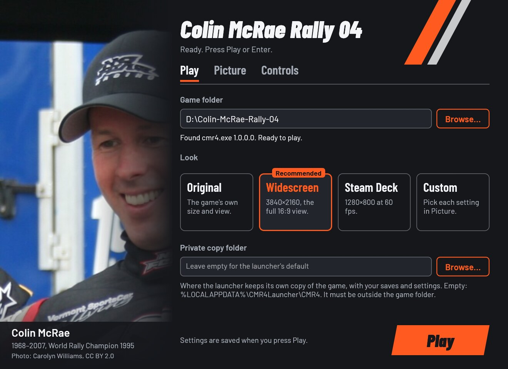
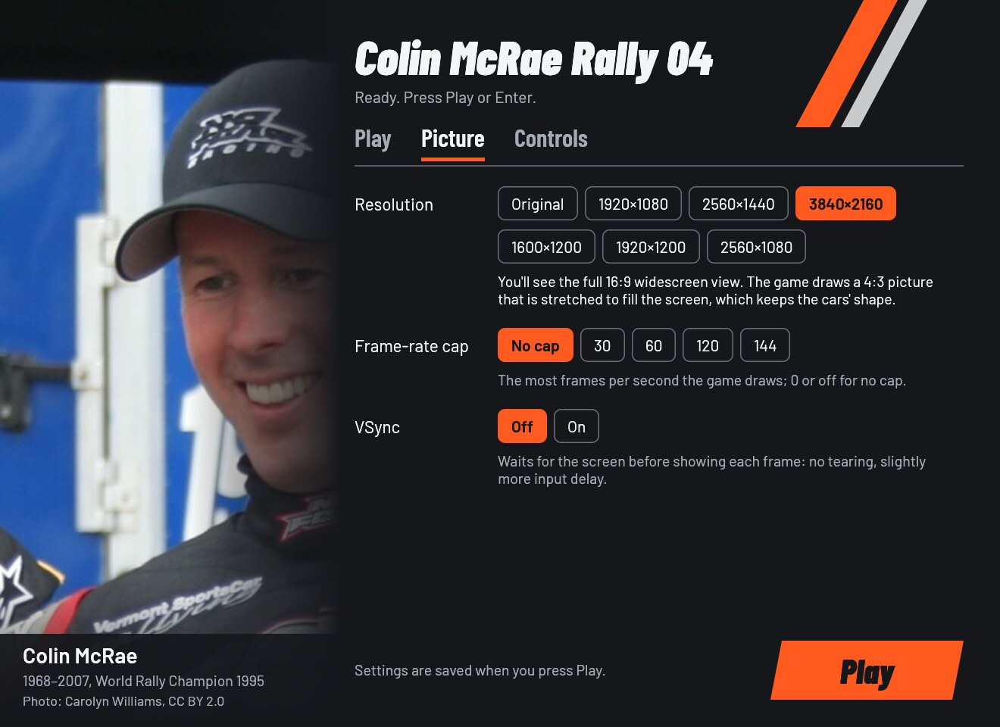
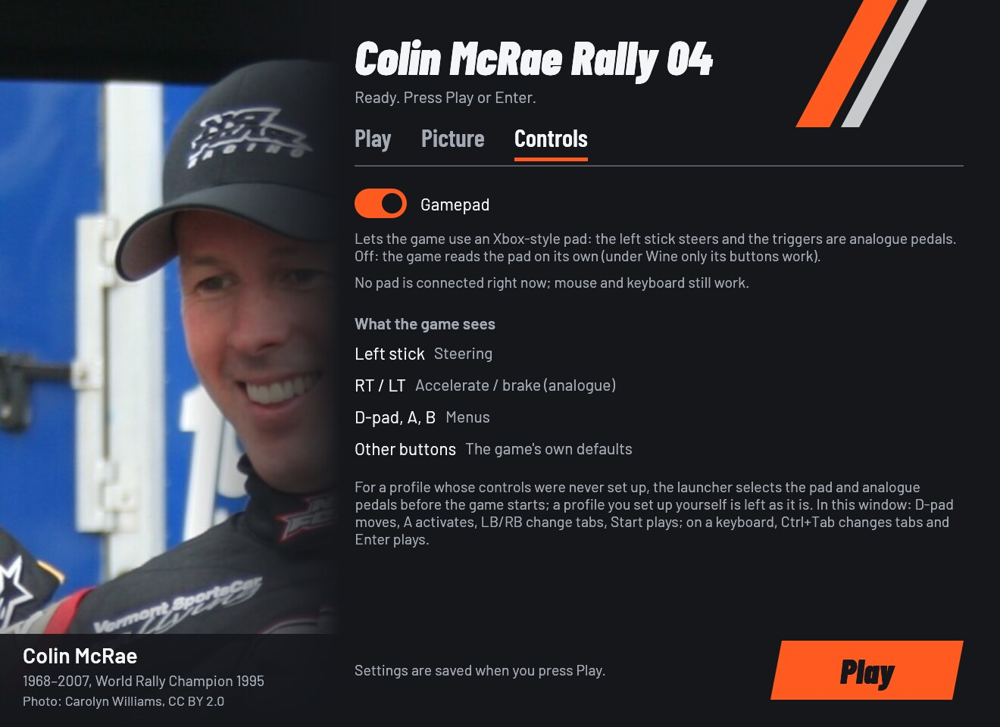
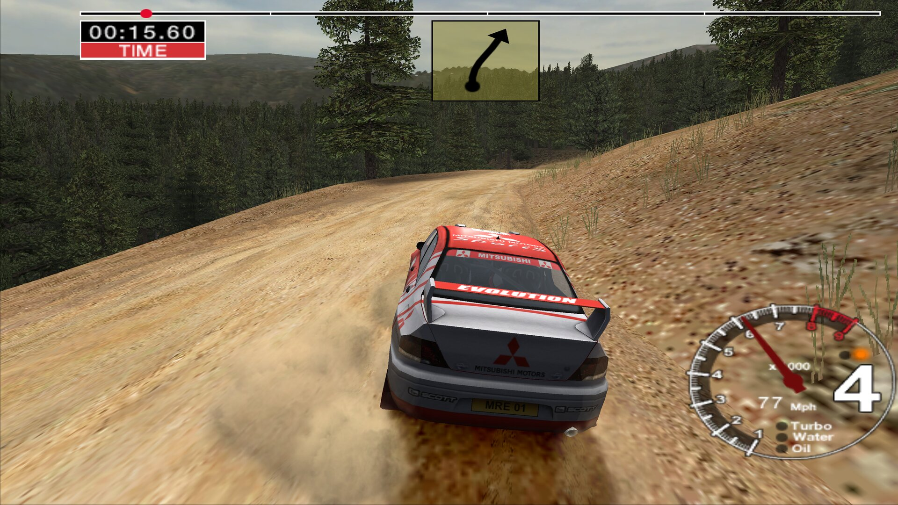

# Colin McRae Rally 04 Launcher

Play your own PC copy of **Colin McRae Rally 04** on Windows 10/11, the
Steam Deck and Linux (Proton, Wine or the AppImage). Point the launcher at
your game folder, pick a look and press **Play**. The widescreen picture,
the graphics wrappers and the gamepad are bundled and set up for you, with
no mods, patchers, winetricks or registry edits by hand. Your game folder
is only read, never changed: the launcher plays from a private copy.

This project contains no game files: you need your own copy of the game.

> Played end to end on Linux under Wine, with gamescope and a gamepad, on
> 4K screens. Native Windows, the Steam Deck, Proton without the helper and
> protected retail discs have not been tested yet. Reports are welcome:
> [open an issue](https://github.com/akitaonrails/rea-colin-mcrae-4/issues/new?template=bug-report.yml).

[](https://new-uploads-akitaonrails.s3.us-east-2.amazonaws.com/2026/11/02/colin-mcrae-rally-04/showcase-h264.mp4)

*From the settings window to a full USA stage under Linux: correct 16:9
proportions on the landscape monitor, driven with a pad's stick and
analogue triggers. Click to watch (2⅓ minutes, with sound).*

## Problems this launcher solves

| Problem | What the launcher does |
| --- | --- |
| The game crashes on a fresh install: it expects its install path and settings in the machine-wide registry, which needs administrator rights, and on Windows a copy written without them may never reach the game. | Keeps the game's settings in your own part of the registry (no administrator rights needed) and points the game there. Writes the install path on every launch, adds first-run defaults only when they are missing, and brings over the settings an older launcher left. |
| The old Direct3D 9 renderer struggles on modern systems. | Installs the tested dgVoodoo2 wrapper. Under Wine or Proton it also adds DXVK, so the game draws through Vulkan on your graphics card. |
| Alt+F4 and closing the window do nothing (Super+W in Hyprland too), so the game had to be killed. | A small hook ends the game when you press Alt+F4 or close its window. |
| The known 16:9 patch squeezes the cars: rendered directly at 16:9, cars and scenery come out 25% too narrow. | The community fix was made for a 4:3 picture stretched to 16:9, so the launcher has the game render 4:3 (2880x2160 for a 4K screen) and dgVoodoo stretches it. You get correct proportions and the wider view. |
| With a portrait monitor set as primary, the picture was fitted to that screen and stretched onto the landscape one: a thin, squashed strip. | Sends the game to your largest landscape monitor. |
| Picking resolution and view by hand. | Choose a look in one click: **Original**, **Widescreen** (the largest 16:9 size that fits your screen), **Steam Deck** or **Custom**. Any 16:9 size gets the widescreen view; other shapes keep the game's own. |
| The pad works in menus but not in a race: with Wine alone the buttons reached the game but the stick and triggers didn't. | Bundled Xidi presents a classic gamepad. The left stick steers, RT and LT are analogue pedals, and a thumb resting on the stick can't open the throttle. |
| Every new player had to set up the pad, and choosing it in the game's menu can freeze the game under Wine. | For a profile whose controls were never set up, the launcher selects your pad, analogue pedals and the game's axis tuning, so you can drive straight away. A profile you set up yourself is left alone. |
| An unknown version of `cmr4.exe` could be patched by guesswork. | The launcher patches only the builds it knows. Any other version still plays, with the game's own view, and the window offers a button to report it. |
| You have the game's installer, not an installed game, and setup programs ask questions or hang under Wine. | Point it at the supported installer's folder: the launcher unpacks the game once with the bundled innoextract, without running the installer, and plays from there. |
| Patches, wrappers and updates could damage your install or overwrite your saves. | The game folder is only read. A private copy holds the patched `cmr4.exe` (which also loads the close hook), the wrappers, settings and saves; later launches update it without touching your saves, settings or DLL mods you added yourself. |

## Screenshots

| Play | Picture | Controls |
| --- | --- | --- |
|  |  |  |



## What you need

Your own copy of **Colin McRae Rally 04**, in one of two forms:

- **An installed game:** a folder with `cmr4.exe` in it.
- **The game's installer** (the one the launcher supports, below): point
  the launcher at its folder and it unpacks the game once, on the first
  **Play**, into a folder of its own. The installer is never run: no setup
  dialogs, no installer code. The launcher reads it with the bundled
  [innoextract](https://constexpr.org/innoextract/), and the installer's
  folder is only read. Unpacking needs about **2.9 GB** free next to the
  launcher's private copy (2.7 GB for the game, plus room to work) and
  takes a few minutes. Afterwards the Game folder setting points at the
  unpacked game, so the installer files are no longer needed.

| Supported installer | Files in its folder |
| --- | --- |
| Magipack's repack ("Colin McRae Rally 04 Repack", EN/FR/DE/ES/IT), a third-party build the project owner chose to support | `Colin McRae Rally 04_Repack_Setup.exe` and its three `…_Setup-1.bin` to `-3.bin` parts |

The repack's own dgVoodoo files (`D3D9.dll`, `dgVoodoo.conf`,
`dgVoodooCpl.exe`) are left out of the unpacked game, because the launcher
brings its own tested dgVoodoo. Any other installer is left alone: the
window and `launcher.log` show its code (the setup program's SHA-256) and
the **Report this installer…** button, so it can be considered. Discs and
other installers: install the game the usual way and point the launcher at
the installed folder.

No installer, disc, executable, media or game data is supplied here.

The launcher knows `cmr4.exe` version 1.0.0.0, also with the community 16:9
fix already applied, and applies the widescreen fix only to it. Any other
version plays without the fix, with the game's own view. The window and
`launcher.log` then show a code (the file's SHA-256) and a link to the
[Unknown edition](https://github.com/akitaonrails/rea-colin-mcrae-4/issues/new?template=unknown-edition.yml)
form. Report the code, never the executable.

Original protected retail discs may not work under Wine (older reports say
so; DRM-free and budget editions were reported working). This project has
not checked either.

## Download and install

Download from the [latest release](https://github.com/akitaonrails/rea-colin-mcrae-4/releases/latest):

- **Windows, Steam Deck and Proton:** `CMR4Launcher-<version>.zip`
- **Linux AppImage:** `CMR4Launcher-<version>-x86_64.AppImage`

### Windows

1. Unzip `CMR4Launcher-<version>.zip` anywhere outside the game folder.
2. Keep `CMR4Launcher.exe` and the `components` folder together.
3. Run `CMR4Launcher.exe`.

The launcher is unsigned, so the first start from a downloaded zip may show
"Windows protected your PC": click *More info*, then *Run anyway*.

### Steam Deck

1. In Desktop Mode, unzip the Windows package, e.g. into
   `~/Games/cmr4-launcher`.
2. In Steam: **Games → Add a Non-Steam Game to My Library…** and pick
   `CMR4Launcher.exe`.
3. **Properties → Compatibility**: force GE-Proton or Proton Experimental.

On a 1280x800 screen the window recommends the **Steam Deck** look, and it
can be driven with a controller. Nothing has been tested on a Deck yet.

### Linux: AppImage

```sh
chmod +x CMR4Launcher-*-x86_64.AppImage
./CMR4Launcher-*-x86_64.AppImage
```

It brings its own portable Wine (11.20), so you don't need to install
Wine. It keeps its Wine prefix in `~/.local/share/cmr4-launcher/prefix`
and uses gamescope when it is installed. When you browse for the game,
your Linux files are drive `Z:`.

### Linux: Steam (Proton)

The same steps as on the Steam Deck, with the zip's `CMR4Launcher.exe`.
Proton brings its own DXVK and runs the launcher without the Linux helper.
This route hasn't been tested apart from the Deck.

### Linux: your own Wine

The zip contains `linux/cmr4-play`, which runs the launcher with your Wine
(and gamescope, when installed):

```sh
linux/cmr4-play          # settings window, then the game
linux/cmr4-play --play   # saved settings, no window (alias: start)
linux/cmr4-play status   # is our session running?
linux/cmr4-play stop     # end our session
```

Variables, gamescope and the prefix are in [linux/README.md](linux/README.md).

## First run

1. On **Play**, press **Browse…** and pick the folder with `cmr4.exe`, or
   the folder with the supported installer. Under Wine your Linux files
   are drive `Z:`, e.g. `Z:\home\you\Games\CMR04`.
2. Pick a look. The window starts on the one recommended for your screen:
   **Widescreen**, or **Steam Deck** on a 1280x800 screen.
3. Press **Play** (or Enter, or Start on a pad).

The first launch copies the game into the private copy (a few GB); later
launches copy only what changed. With an installer, the first **Play**
first unpacks the game, with a progress window and a **Stop unpacking**
button (Escape, or B on a pad); stopping removes what was copied so far.
The window opens whenever someone may be watching, also under the Linux
helper; `launcher.log` records each step.

## The settings window

**Play** holds the game folder, the look and the private copy folder.
**Picture** sets the resolution, a frame-rate cap and VSync. **Controls**
turns the Gamepad on or off and shows what the game sees. Settings are
saved when you press **Play**.

| Look | Resolution | View | Frame-rate cap | When to pick it |
| --- | --- | --- | --- | --- |
| **Original** | the game's own mode | the game's own | unchanged | to play the game as it shipped |
| **Widescreen** | the largest 16:9 size that fits your screen, up to 3840x2160 | widescreen | unchanged | recommended on most screens |
| **Steam Deck** | 1280x800, filling the 16:10 screen | the game's own | 60 | recommended on a 1280x800 screen |
| **Custom** | your choice in **Picture** | depends on the resolution | your choice | any change in **Picture** |

The look itself isn't stored: the window works it out from the saved
values. The first time it opens (no `launcher.cfg` yet) it picks the
recommended look for your screen.

**Picture** offers Original, your screen's own 16:9 fit when it isn't a
standard size, 1920x1080, 2560x1440 and 3840x2160 (16:9), 1600x1200 (4:3),
1920x1200 (16:10) and 2560x1080 (ultrawide); a frame-rate cap (no cap, 30,
60, 120, 144); and VSync. A 16:9 size gets the widescreen view (the game
draws a 4:3 picture that dgVoodoo stretches, which keeps the cars' shape);
other shapes keep the game's own view. A value from `launcher.cfg` or the
command line that isn't in the list shows as "(saved)" and is kept.

The window works with a pad (D-pad moves, A activates, LB/RB switch tabs,
Start plays) and with the keyboard alone (Tab moves, arrows pick, Ctrl+Tab
switches tabs, Enter plays). A greyed-out **Play** says why it can't start
yet.

## Gamepad

With **Controls → Gamepad** on (the default; it uses the bundled Xidi):

| On the pad | In menus | In a race |
| --- | --- | --- |
| Left stick | | Steering (analogue) |
| RT / LT | | Accelerate / brake (analogue) |
| D-pad, A, B | Move, select, back | |
| X, Y, LB, RB … | | Handbrake, camera, gears (the game's defaults) |

On launch, a profile that still has the factory controls (keyboard,
digital pedals, untouched bindings) gets the connected pad, analogue
pedals and the axis tuning the game itself writes, so you can drive
without opening Options. The launcher picks the pad that is connected when
you start, so **wake a wireless pad before launching**. If none is
connected, the profile is left as it is and set up next time.

If you set the controls up yourself (or change pads), do it in
**Options → Controllers**: pick the controller, set Accel/brake to
Analogue, then select Accelerate and pull RT, Brake and pull LT, Turn
left/right and move the stick. The game labels the trigger axis "Z axis";
that is expected. Choosing the controller in that menu can freeze the game
under Wine. The choice is saved before the freeze, so restart and it is in
effect.

With the Gamepad off, the game reads the pad through Windows or Wine
directly. Buttons and the D-pad work, but under Wine the pad's axes did
not drive the car in our tests, so keep it on unless your setup needs
otherwise.

## Options

Every option has the same name in the window, in `launcher.cfg` (with
underscores) and as a flag (with hyphens). The first run writes a
`launcher.cfg` with every key and its description, unset; where the file
lives is under [Where things live](#where-things-live).

| `launcher.cfg` / flag | In the window | Values | Unset | What it changes |
| --- | --- | --- | --- | --- |
| `game` / `--game` | Play: Game folder | a folder | the launcher's own folder, if `cmr4.exe` is there | The folder of your installed game, or of the supported installer (unpacked once, never run; then this setting points at the unpacked game). It is only read, never changed. |
| `look` / `--look` | Play: Look | `original`, `widescreen`, `steam_deck` | no look: the values below | Sets the look's resolution and frame-rate cap. Values set next to it win. |
| `resolution` / `--resolution` | Picture: Resolution | `WxH` (320x240 to 7680x4320) or `original` | the launcher picks one from your screen and saves it | The picture size. A 16:9 size shows the full widescreen view; other shapes keep the game's own view. |
| `fps_limit` / `--fps-limit` | Picture: Frame-rate cap | 0 to 1000; `0` or `off` is no cap | no cap | The most frames per second the game draws. |
| `vsync` / `--vsync` | Picture: VSync | `on`, `off` | off | Waits for the screen before showing each frame: no tearing, slightly more input delay. |
| `controller` / `--controller` | Controls: Gamepad | `on`, `off` | on | Lets the game use an Xbox-style pad through Xidi: the left stick steers and the triggers are analogue pedals. |
| `runtime` / `--runtime` | Play: Private copy folder | a folder outside the game folder | `%LOCALAPPDATA%\CMR4Launcher\CMR4` | Where the launcher keeps its own copy of the game, with your saves and settings. |

`on`/`off` also accept `true`/`false`, `yes`/`no` and `1`/`0`. An invalid
value or an unknown key is logged as a warning and the rest of the file
still applies. Saving from the window, or remembering `--game`, changes
only the launcher's own lines; your comments and any other lines are
kept. The old `widescreen` key and `--widescreen` flag are accepted and
ignored, because the resolution now decides.

With no options the settings window opens. Any option skips the window and
plays. Options override `launcher.cfg` for that run only; the one
remembered is the game folder (`--game`). After unpacking an installer,
the saved game folder is changed to the unpacked game, except when the
folder came from `--game`: then the launcher only says where the game is
(in `launcher.log`), and the next `--game` should name that folder. When neither the file nor
`--resolution`/`--look` sets a resolution, the one the launcher picks from
the screen is saved too, except inside gamescope, whose screen is only
gamescope's own size.

The launcher's own switches:

| Switch | What it does |
| --- | --- |
| `--check` | Checks the game and the settings without playing; the result goes to `launcher.log` and the terminal (or a dialog). For an installer it says where the game will be unpacked and how much space that needs, and fails when there isn't enough; it never unpacks. Fails (exit 5) while another launcher is open. |
| `--no-window` | Plays with the saved settings and the flags given. |
| `--settings` | Opens only the settings window (the Linux helper uses it). |
| `--linux` | Says the Linux helper (`cmr4-play`) started the launcher. |
| `--help` | Shows the options. |

Exit codes for scripts: after playing, the game's own exit code; 0 when
`--check` finds everything ready; 1 for any error, a bad flag or value
included. With `--settings`: 0 Play
pressed, 3 window closed without Play, 4 no window possible. Starting a
second launcher brings the open window to the front (exit 0); while the
game runs it says so and doesn't start a second copy (exit 5). Play is
refused the same way while the game still runs from the launcher's
private copy (after a launcher was ended while playing).

## Where things live

| What | Windows | Linux (AppImage, `cmr4-play`) |
| --- | --- | --- |
| Settings (`launcher.cfg`) and log (`launcher.log`) | `%LOCALAPPDATA%\CMR4Launcher\` | in the prefix, `drive_c/users/<you>/AppData/Local/CMR4Launcher/` |
| The launcher's copy of the game (runtime) | `%LOCALAPPDATA%\CMR4Launcher\CMR4` (or `runtime`) | in the prefix, `drive_c/users/<you>/AppData/Local/CMR4Launcher/CMR4` |
| The game unpacked from an installer | beside the runtime: `%LOCALAPPDATA%\CMR4Launcher\CMR4-game` (or `<runtime>-game`) | in the prefix, `…/CMR4Launcher/CMR4-game` |
| Your saves | inside the runtime, next to its `cmr4.exe` | the same |
| Wine prefix | — | `~/.local/share/cmr4-launcher/prefix` |
| `cmr4-play`'s files (the window's error output, the session lock) | — | `~/.config/cmr4-launcher` |

A `launcher.cfg` next to `CMR4Launcher.exe` is used instead (portable
setup). Under Proton everything above is inside Steam's
`compatdata/<appid>/pfx`.

**Your saves live only in the private copy.** The game writes its profiles
and settings (`OPTIONS`), championships (`CHAMPIONSHIP_SLOT_*`) and best
times (`BESTTIMES_GHOSTS`) next to the runtime's `cmr4.exe`. The launcher
never overwrites them when it updates the copy, and it never writes them
back to the game folder.

Registry entries the launcher writes:

- **The game's key**, on Windows and in the Wine prefix:
  `HKCU\Software\Codemasters\Colin McRae Rally 04` (the install path,
  resolution, language and the game's own graphics choices). The game
  looks for it under `HKLM`; the launcher's hook DLL in the private copy
  sends it here, so no administrator rights are needed. Launchers before
  0.5.1 wrote it to
  `HKLM\SOFTWARE\WOW6432Node\Codemasters\Colin McRae Rally 04` or the
  same under `HKCU\Software\Classes\VirtualStore`; the first start of
  0.5.1 copies the game's settings from there, and then that old key is
  no longer used (you can delete it).
- **Windows only, the high-performance GPU for the private copy:** under
  `HKCU\Software\Microsoft\DirectX\UserGpuPreferences`, the value named
  after the runtime's `cmr4.exe` (for example
  `…\CMR4Launcher\CMR4\cmr4.exe`) = `GpuPreference=2;`, written once when
  that exe has no GPU choice yet. `launcher.log` says when.
- **Wine only, inside the prefix:** `cmr4.exe`'s DLL overrides
  (`HKCU\Software\Wine\AppDefaults\cmr4.exe\DllOverrides`, with a
  record of the ones it wrote under
  `HKCU\Software\rea-launcher\DllOverrides\cmr4.exe`), the
  controller mapping (`Map Controllers` under
  `HKLM\System\CurrentControlSet\Services\winebus`, when absent) and
  `UseEGL` = `N` (`HKCU\Software\Wine\X11 Driver`, when absent).

`launcher.log` records what the launcher did and why: the game version and
its SHA-256, the look and settings, each bundled DLL with its SHA-256, the
DLL overrides and close-hook setup (`REA_CLOSE_HOOK`,
`REA_CLOSE_HOOK_ATTACH`) given to the game,
the monitor and dgVoodoo output it chose, and the `controller setup:` step. It starts afresh past 1 MiB. Remove personal
paths before posting it.

## Troubleshooting

- **"This cmr4.exe is a version the launcher doesn't know yet":** the game
  still plays, without the widescreen view. Press **Report this version…**
  (or open the [Unknown edition](https://github.com/akitaonrails/rea-colin-mcrae-4/issues/new?template=unknown-edition.yml)
  form) and give the code it shows and where your copy comes from. Don't
  attach `cmr4.exe`.
- **"… is an installer this launcher doesn't know, so it was left
  alone":** the folder holds an Inno Setup installer other than the
  supported one. Install the game the usual way and choose the installed
  folder, or press **Report this installer…** to send its code.
- **"… is missing" or "… has N bytes instead of …":** a part of the
  installer is missing or incomplete; copy or download it again. The
  launcher checks every unpacked file's checksum too, and a damaged part
  stops the unpack with nothing left behind.
- **"Unpacking the game needs about 2.9 GB free":** free some space on
  the private copy's drive, or choose a private copy folder on another
  drive (the unpacked game sits next to it).
- **The pad doesn't drive:** keep the Gamepad on, wake the pad before
  launching, check the `controller setup:` lines in the log, and set the
  controls once in Options → Controllers as described above.
- **The picture is in the wrong place or squashed:** the log's
  `display/render policy` line names the monitor and dgVoodoo output.
  Report it with your monitor layout.
- **A DLL conflict in the private copy:** the launcher won't replace a DLL
  there that it didn't install. Move your own DLL aside or use a
  fresh private copy folder.
- **The game hangs after the in-game Advanced Graphics menu:** avoid that
  menu; it rewrote the resolution and hung in testing. The launcher sets
  its resolution again on every launch.
- **Anything else:** run `CMR4Launcher.exe --check`, then open a
  [bug report](https://github.com/akitaonrails/rea-colin-mcrae-4/issues/new?template=bug-report.yml)
  with `launcher.log` attached (remove personal paths). Never attach game
  files.

## Known limitations

- The HUD (speedometer, timer) is drawn for 4:3 and stays slightly wide at
  16:9. Fixing it would need another patch to the game.
- The frame-rate cap and VSync have not been checked in the game yet.
- Not tested yet: native Windows, the Steam Deck (Desktop and Game Mode),
  Proton without the helper, protected retail discs and pads other than an
  8BitDo Ultimate 2. The latest launcher's ways of quitting the game and
  the one-launcher-at-a-time rule have been tested only without the game.

What was tested, on Linux with Wine 11.21, an RTX 5090 and 4K screens:
correct 16:9 proportions with a portrait primary monitor present, Super+W
ending the game, stick steering and analogue pedals in a stage, a
brand-new profile driving without opening Options, and the settings window
with a pad. The details and the evidence behind each fix are in
[docs/RUNTIME_NOTES.md](docs/RUNTIME_NOTES.md) and
[docs/RESEARCH.md](docs/RESEARCH.md).

## Uninstall

1. **Back up your saves first.** They are only in the private copy (see
   [Where things live](#where-things-live)): `OPTIONS`,
   `CHAMPIONSHIP_SLOT_*` and `BESTTIMES_GHOSTS` next to the runtime's
   `cmr4.exe`. The steps below delete them.
2. Delete the launcher's folder (or the AppImage).
3. Windows: delete `%LOCALAPPDATA%\CMR4Launcher` (settings, log, the
   private copy and, if you used an installer, the unpacked game; a few
   GB each). In the registry, delete the value under
   `HKCU\Software\Microsoft\DirectX\UserGpuPreferences` named after the
   private copy's `cmr4.exe`, and the game's key
   (`Codemasters\Colin McRae Rally 04`, see
   [Where things live](#where-things-live)) only if you no longer play the
   game itself.
4. Linux: delete `~/.local/share/cmr4-launcher` (the prefix, with the
   private copy) and `~/.config/cmr4-launcher`, after copying the saves
   out. With Proton, removing the Steam shortcut offers to delete its
   prefix, saves included. The Wine registry entries live in the prefix
   and go with it.

Your game folder (or installer folder) was never changed, so there is
nothing to undo there.

## For developers

The toolchain is Rust (edition 2024), MinGW-w64 for the 32-bit Windows
target with lld, Wine for the Windows-target tests and `cargo-deny`; the
[`gaming` distrobox](https://github.com/akitaonrails/distrobox-gaming) has
them all. Windows builds link with lld (`.cargo/config.toml`): GNU ld 2.47
leaves some imports unresolved and the launcher then crashes at startup.

```sh
cargo fmt --all --check
cargo test --workspace --locked                 # host tests, the window headless
cargo clippy --release --target i686-pc-windows-gnu --all-targets -- -D warnings
cargo deny check
for t in linux/tests/*.sh packaging/tests/*.sh; do sh "$t"; done
cargo build --release --locked --target i686-pc-windows-gnu
sdk/scripts/wine-test --locked --workspace      # Windows-target tests under Wine, headless
sh ../rea-launcher-sdk/scripts/sdk-sync --check .   # sdk/ matches the pinned SDK tag
packaging/build-windows.sh dev .work/packages .work/components-cache
```

`packaging/build-windows.sh` also builds the SDK's close hook
(`cargo build -p rea-launcher-close-hook`, producing `rea_close_hook.dll`)
and checks both binaries' imports (`sdk/packaging/check-imports.sh`).

- Moving to a new SDK: `sdk/scripts/sdk-bump vX.Y.Z` (Cargo tags, `sdk/`,
  workflow pins; prints the Migration notes), see
  `sdk/docs/playbooks/sdk-change.md`. A weekly workflow opens that pull
  request by itself.
- Freeing disk space after a release: `sdk/scripts/clean` (dry run), then
  `sdk/scripts/clean --yes`.
- Golden snapshots in `tests/snapshots/` hold `--help`, the template and
  the launch plan of each look: regenerate with
  `CMR4_UPDATE_SNAPSHOTS=1 cargo test --test snapshots` and review every
  diff.
- Tests never open a window and never need the game. The settings window
  is tested with `egui_kittest` (`src/e2e.rs`, `src/window.rs`); every
  option is tested from window control and flag to what it writes,
  through `plan::plan`. `CMR4_GAME_DIR=<game folder> cargo test --
  --ignored` also checks the widescreen patch against your real
  `cmr4.exe` (read only).
- Components are downloaded at package time from pinned URLs and checked
  by SHA-256 (`packaging/components.pins`); archives are never committed.
  The licence-less dgVoodoo2 2.80 archive comes from this repository's
  `thirdparty` release (`packaging/mirror/README.md`). The package check
  accepts only an exact file list and rejects game assets. GitHub Actions
  (the SDK's reusable workflows) test, build the zip and the AppImage, and
  a `v*` tag publishes the release.
- The AppImage is built from the unpacked Windows package with the SDK's
  `sdk/packaging/appimage-wine.sh`, which downloads Wine, appimagetool and
  the AppImage runtime from their official releases and checks the SHA-256
  digests pinned in `sdk/packaging/appimage/tools.pins`:

  ```sh
  sdk/packaging/appimage-wine.sh --app cmr4 --exe CMR4Launcher.exe \
    --icon packaging/appimage/cmr4-launcher.png \
    --desktop packaging/appimage/cmr4-launcher.desktop \
    --payload components --doc licenses --doc docs \
    <unpacked-package-folder> <output-folder>
  ```

  Wine's source and LGPL notices are in the AppImage under
  `usr/share/doc/wine`.
- More: [AGENTS.md](AGENTS.md) (rules for contributors and agents),
  [docs/RESEARCH.md](docs/RESEARCH.md),
  [docs/RUNTIME_NOTES.md](docs/RUNTIME_NOTES.md),
  [docs/CONTRIBUTIONS.md](docs/CONTRIBUTIONS.md),
  [docs/ENHANCEMENTS.md](docs/ENHANCEMENTS.md).

## Built on rea-launcher-sdk

The runtime copy, the `launcher.cfg` option table, patch tables, Win32
helpers, the settings window kit, the close hook, the Linux play library
(`rea-play.sh`), packaging scripts and CI workflows come from
[rea-launcher-sdk](https://github.com/akitaonrails/rea-launcher-sdk),
shared by the rea launchers. It is pinned by tag in `Cargo.toml` and
vendored in `sdk/` (the tag is in `sdk/VERSION`). This repository keeps
what is specific to Colin McRae Rally 04: its editions and patch, the
registry values, components and their settings, the looks, the gamepad
profile and `cmr4-play`'s settings.

## Contributing

- **About Colin McRae Rally 04** (its editions, fixes, picture, gamepad,
  saves, settings, `cmr4-play`'s game settings, this README): issues and
  pull requests here.
- **Shared code** (the runtime folder, settings-window widgets, the option
  table, the close hook, `rea-play.sh`, packaging, CI workflows, anything
  under `sdk/`): issues and pull requests at
  [rea-launcher-sdk](https://github.com/akitaonrails/rea-launcher-sdk/issues).
- **How to tell:** code under `sdk/` or from a `rea_launcher*` crate is the
  SDK's. If the same problem would happen with another rea launcher, it's
  the SDK's. Not sure? Open it here and it will be moved.
- Never patch `sdk/` or copy SDK code here: fix the SDK and bump the tag.
- Never attach game files (executables, saves, data) to an issue.
- Test reports are welcome, working or not: the
  [bug report](https://github.com/akitaonrails/rea-colin-mcrae-4/issues/new?template=bug-report.yml)
  form has a "What worked?" checklist.

## Credits

- **AuToMaNiAk005**: the 16:9 "Low" widescreen fix the launcher applies.
- **Dege**: [dgVoodoo2](https://dege.freeweb.hu/dgVoodoo2/dgVoodoo2/).
- **Philip Rebohle and contributors**: [DXVK](https://github.com/doitsujin/dxvk).
- **Samuel Grossman**: [Xidi](https://github.com/samuelgr/Xidi).
- **Chris Robinson and contributors**: [DSOAL](https://github.com/kcat/dsoal),
  which the launcher keeps when you installed it.
- **Carolyn Williams**: the photo of Colin McRae in the window
  ([CC BY 2.0](https://www.flickr.com/photos/8365241@N02/1429137255/)).
- **Jeremy Tribby**: the [Barlow](https://github.com/jpt/barlow) fonts (SIL OFL 1.1).
- **WineHQ** and **Kron4ek**: Wine and the portable build in the AppImage;
  **AppImage** project: appimagetool and its runtime.
- [PCGamingWiki](https://www.pcgamingwiki.com/wiki/Colin_McRae_Rally_04)'s
  CMR04 page, where the fixes above were found.
- [rea-launcher-sdk](https://github.com/akitaonrails/rea-launcher-sdk): the
  shared launcher code.

Full list with licences: [THIRD_PARTY.md](THIRD_PARTY.md).

## Legal

Colin McRae Rally 04 is © Codemasters. This project is not affiliated with
or endorsed by Codemasters or Electronic Arts. It contains no game files and
only runs a copy you own. Our code is MIT OR Apache-2.0
([LICENSE-MIT](LICENSE-MIT), [LICENSE-APACHE](LICENSE-APACHE)); bundled
binaries, fonts, the portrait photo and Wine keep their own licences, listed
in [THIRD_PARTY.md](THIRD_PARTY.md).
